  

  

  
  

## 🌲 About Me

- 🌿 I'm currently working on a project involving my local public school district.

## 🧰 Toolkit

  
  
  
  
  
  
  

## 📊 Growth Rings

  
  

  

  

## 🍂 Find Me

  
  

  

